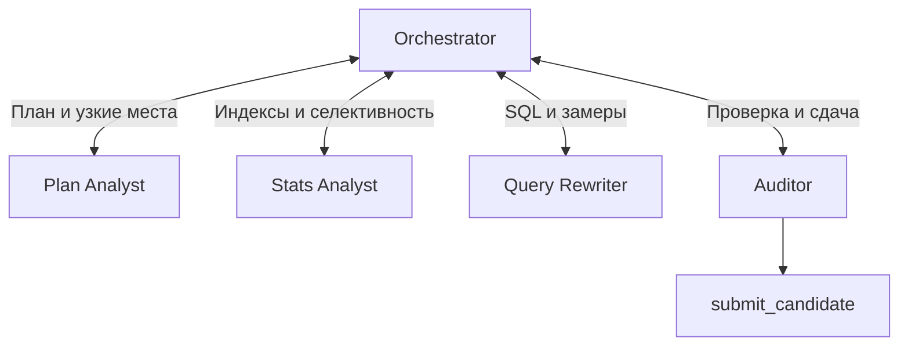
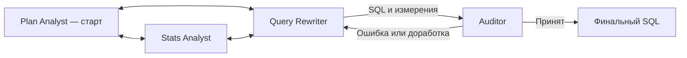

# Single Agent vs Orchestrator vs Swarm: оптимизация SQL

## Исследовательский вопрос

Помогает ли разделение работы между агентами найти более быстрый SQL, чем один агент?

Задача — ускорить сложный отчёт PostgreSQL по клиентам, заказам, оплатам, возвратам, скидкам, доставкам и поставщикам, сохранив результат. Исходный запрос многократно повторяет фильтрацию заказов и вычисляет показатели коррелированными подзапросами.

## Эксперимент

Три модели — **DeepSeek-V4-Flash-0731, GPT-5.6-Luna, GPT-5.6-Sol** — и три архитектуры. Внутри каждой архитектуры все роли используют одну выбранную модель и общий набор инструментов.

Для каждой комбинации сохранены **три независимо полученных финальных SQL**. В последнем эксперименте эти 27 SQL повторно измерены **на сервере без участия ИИ**: по 10 пар «baseline + кандидат», всего **270 пар**. Все запросы прошли детерминированную проверку эквивалентности на тестовой БД.

Порядок SQL перемешивается в каждом из 10 блоков; внутри пары чередуется порядок baseline и кандидата. Перед каждой парой выполняется прогрев. SQL исполняются последовательно, измеряется выполнение с получением полного результата.

## Результат: ускорение относительно baseline

| Модель | Single Agent | Orchestrator | Swarm |
|---|---:|---:|---:|
| DeepSeek-V4-Flash-0731 | **1,90×** | 1,88× | 1,74× |
| GPT-5.6-Luna | 1,91× | **2,03×** | 2,02× |
| GPT-5.6-Sol | 2,00× | **2,04×** | 1,92× |

**Как читать:** 2× означает выполнение примерно вдвое быстрее baseline, то есть сокращение времени примерно на 50%. Для каждого SQL берётся медиана 10 парных отношений `время baseline / время кандидата`; ячейка — медиана трёх таких результатов. Жирным выделен максимум строки, без заявления о статистической значимости.

**Лучший отдельный SQL — DeepSeek Single: 2,69×**, медиана времени кандидата — **0,84 с**. Это один удачный результат; медиана трёх решений этой группы — 1,90×.

## Как устроены подходы

### Single Agent: весь цикл у одного агента


Один агент сохраняет контекст исследования и сам выбирает следующий шаг. Например: замечает повторные вычисления → выносит заказы в общую выборку → сравнивает варианты агрегации → сдаёт лучший проверенный SQL.

### Orchestrator: специалисты возвращают результат руководителю



Центральный агент выбирает специалиста и объединяет ответы. Реализация — **agents-as-tools**: вызовы `ask_plan_analyst`, `ask_query_rewriter` и других специалистов. Сам orchestrator работает через специалистов; каждый специалист имеет доступ к общим инструментам БД.

**Пример взаимодействия:** orchestrator поручает Plan Analyst найти повторную работу, затем передаёт находки Query Rewriter. Тот возвращает SQL с общей выборкой заказов и предварительными агрегатами. Orchestrator отправляет кандидат Auditor, который вызывает детерминированную проверку. При проблеме управление возвращается руководителю для следующего поручения. Это пример маршрута, а не обязательная последовательность всех запусков.

### Swarm: специалист сам передаёт управление следующему



Постоянного руководителя нет. Реализация — **LangGraph Swarm**; активный специалист вызывает `transfer_to_<роль>`, и следующий продолжает работу. В этой реализации управление переходит последовательно; swarm не означает одновременный запуск всех агентов.

**Реальный пример Luna Swarm:** Plan Analyst обнаружил шесть повторяющихся подзапросов и передал выводы напрямую Query Rewriter. Тот подготовил общую выборку заказов и независимые агрегаты, затем передал SQL и замеры Auditor. Auditor подтвердил кандидат через `submit_candidate`. Stats Analyst в этом маршруте не понадобился. При неудачной проверке допустим обратный handoff к Query Rewriter.

Передаваемое состояние одинаково компактно для делегирования и handoff:

```text
task          — исходная задача
hypothesis    — что улучшить и почему
evidence      — короткие факты из инструментов
candidate_sql — текущий кандидат, если есть
```

Полная история не пересылается каждому специалисту. В swarm при передаче заменяется старый контекст; полная трасса сохраняется отдельно.

## Общие инструменты

| Инструмент | Назначение |
|---|---|
| `get_capabilities()` | Разрешённые действия текущего профиля |
| `get_schema()` | Таблицы, столбцы и связи |
| `get_indexes()` | Существующие индексы |
| `get_statistics()` | Статистика и селективность |
| `explain(sql)` | План без выполнения |
| `explain_analyze(sql)` | Фактический план и время узлов |
| `execute(sql)` | Ограниченное чтение данных |
| `benchmark(sql, n)` | Повторные замеры кандидата |
| `submit_candidate(sql)` | Проверка эквивалентности и финальные замеры |

В этом эксперименте разрешено **только переписывание SQL**. Индексы и статистика служат диагностике; создание индексов, изменение настроек, подсказки `pg_hint_plan` и Jev не использовались. Производительность оценивает код, а не LLM-судья.

## Какие решения дали результат

**Общий приём — убрать повторную работу:** один раз отобрать нужные заказы, отдельно агрегировать показатели по `customer_id`, затем соединить небольшие результаты. Раздельные агрегаты также предотвращают размножение сумм при соединениях «один ко многим»; `EXISTS` сохраняет проверку наличия оплаты без дублирования заказов.

| Подход и пример | Что содержал финальный SQL | Почему это может ускорять |
|---|---|---|
| **Single / DeepSeek, лучший SQL** | Общие оплаченные заказы; выручка как продажи минус отдельно посчитанные возвраты; общие поздние доставки; уникальные пары клиент–поставщик | Переиспользование выборок и отдельная обработка возвратов; сокращение повторных соединений |
| **Orchestrator / Sol** | Материализованные выборки заказов, оплаченных заказов и поздних доставок; независимые агрегаты; отбор клиентов через `EXISTS` | Несколько показателей используют уже подготовленные наборы, без повторения исходных подзапросов |
| **Swarm / Luna** | Общая материализованная выборка заказов; отдельные агрегаты оплат, выручки, скидок, доставок и поставщиков | Та же декорреляция: агрегировать набор целиком, затем присоединить итоги к клиентам |

Это реальные примеры сохранённых решений, а не уникальные способности архитектур. Замерено ускорение **всего SQL**; вклад каждого отдельного изменения не изолировался. Материализация сама по себе не гарантирует улучшения — результат зависит от размера и повторного использования промежуточных наборов.

## Что можно заключить

Все комбинации нашли рабочие ускорения; типичный результат — около **2×**. У Luna и Sol лучший групповой результат у orchestrator, у DeepSeek — у single. **Универсального выигрыша от многоагентности этот эксперимент не показал.** Удачная SQL-гипотеза оказалась важнее самого наличия нескольких ролей.

Серверный baseline стабилен в рамках серии: медиана **2,27 с**, центральные 50% замеров — **2,25–2,31 с**. Среда: PostgreSQL 16.4, общий сервер с 8 CPU и 15 GiB RAM, контейнер БД ограничен 1 GiB. Данные фиксированы, статистика собрана перед прогоном.

Три решения на комбинацию и одна задача ограничивают обобщение. Последний эксперимент сравнивает качество готовых SQL; стоимость генерации, токены и окупаемость координации в нём заново не измерялись.

---

Источник чисел: [серверный отчёт по 27 SQL](presentation/materials/report.md), [сырые парные замеры](presentation/materials/samples.jsonl). Дата эксперимента: 22 сентября 2026.
